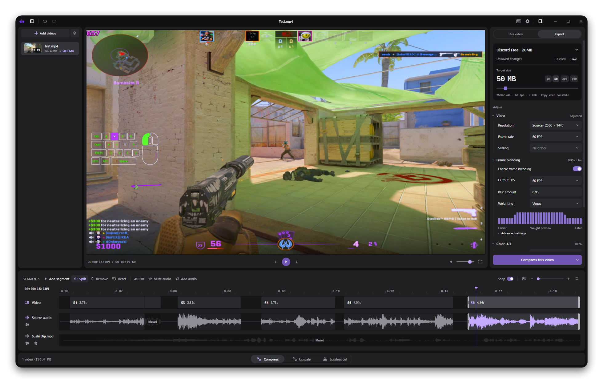

<div>
<h1 align="center">
  <a href="https://github.com/aechXIII/Tuck"></a>
  <br>
  Tuck
</h1>

<p align="center"><strong>Trim, compress, and upscale videos on Windows and Linux.</strong></p>

<p align="center">
    <a href="https://github.com/aechXIII/Tuck/releases/latest"></a>
    <a href="https://github.com/aechXIII/Tuck/releases"></a>
    
    
    <a href="LICENSE"></a>
  <a href="https://x.com/aechxiii">
  
</a>
  </p>
</div>

---

Tuck is a simple video editor for Windows and Linux, built around FFmpeg.
Trim clips or cut them without re-encoding, edit audio, crop or resize videos,
and export to a file size or resolution you choose.



## Download

Tuck supports Windows 10 and 11 and x86-64 Linux. Both packages include FFmpeg and
ffprobe and support signed updates from inside the app.

Linux uses software encoding. Hardware encoding, File Explorer's **Send To** menu,
and the command-line tools are available on Windows only.

### Windows

Download the Windows installer from the [Releases page](https://github.com/aechXIII/Tuck/releases/latest), run it, and open Tuck. FFmpeg and ffprobe are included; no separate installation is needed. Setup installs the WebView2 Runtime if it is missing, which requires an internet connection.

To use your own FFmpeg tools, select them in **Settings > Media tools**.

### Linux AppImage

Install Tuck and add it to the application menu with this command. It requires
`curl`, `python3`, and `sha256sum`. No `sudo` needed. Run it again to update:

```bash
curl -fsSL https://raw.githubusercontent.com/aechXIII/Tuck/main/scripts/install-linux.sh | sh
```

Or run the x86-64 AppImage directly after making it executable:

```bash
chmod +x Tuck-*-x86_64.AppImage
./Tuck-*-x86_64.AppImage
```

When the AppImage file is writable the app updates in place. When it is not, it
shows the release notes with a download link.

The AppImage needs a Linux desktop session. It includes WebKitGTK, Python,
FFmpeg/ffprobe, and the plugins used for video previews.

- If the AppImage reports that FUSE is missing, run
  it with `./Tuck-*-x86_64.AppImage --appimage-extract-and-run` (or
  `tuck --appimage-extract-and-run` after using the installer script).
- Tuck uses the GPU for smoother previews. In a virtual machine, or after a
  crash, it switches to software drawing.
- If the window stays blank, launch with
  `WEBKIT_DISABLE_COMPOSITING_MODE=1 ./Tuck-*-x86_64.AppImage` to draw without
  the GPU.
- If only video previews stay blank, try launching with
  `TUCK_WEBKIT_COMPOSITING=1 ./Tuck-*-x86_64.AppImage`.
- To always use the GPU, launch with
  `TUCK_WEBKIT_ACCELERATED=1 ./Tuck-*-x86_64.AppImage`.

## Features

- **Timeline editing:** Split a video into segments, trim or remove unwanted parts, and mute source audio or individual fragments.
- **Audio editing:** Add new audio files and position them on the timeline. Imported audio can be moved, trimmed, split, muted, or given its own volume level.
- **Crop and resize:** Crop directly in the preview, rotate in 90-degree steps, flip the
  picture horizontally or vertically, and choose **Fit**, **Fill**, or **Stretch** for the
  output frame.
- **Lossless cut:** Remove parts of a video and join the rest without re-encoding. See [Lossless cut](#lossless-cut).
- **Compression and upscaling:** Compress to a chosen file-size limit, or upscale to 1440p, 4K, or a custom resolution. Choose a target-size preset of 20, 50, 200, or 500 MB, or enter your own limit.
- **Encoding queue:** Queue multiple videos, reorder pending exports, cancel a pending or running export, and retry failed or cancelled exports. Use software encoding on either platform or supported NVIDIA and AMD hardware on Windows.
- **Settings:** Change keyboard shortcuts, the accent color and interface size, choose where exports are saved and what happens when a file name is taken, and hide parts of Tuck you don't use.
- **Profiles and Windows integration:** Save reusable profiles, import or export profiles, drag videos into Tuck, and add Tuck or a specific profile to File Explorer's **Send To** menu.

## Use

1. Add one or more videos and select the clip you want to edit.
2. Make any timeline, audio, crop, or sizing changes.
3. Choose **Compress**, **Upscale**, or **Lossless cut** at the bottom of the window. For Compress
   and Upscale, pick a profile in the Export Inspector. Then start the export.

Press `?` to see every keyboard shortcut. You can change them in **Settings > Keyboard**.

## Lossless cut

Lossless cut keeps the parts you choose and joins them without re-encoding, so the video keeps its
full quality. It works with MP4, MOV, MKV, WebM, MPEG-TS and AVI, and keeps audio tracks, subtitles
and chapters.

- **On keyframes** copies the video as it is. Each part has to start on a keyframe, so it can start
  a little later than you set. The Inspector tells you when that happens.
- **Exact (Beta)** keeps the exact frames you chose by re-encoding a few frames at each cut.
- Press `[` and `]` to jump between keyframes.
- To cut every video in the Library at once, use **Export all cuts**.

Every cut is checked before it's saved. If Tuck can't check something, the cut is still saved and
marked **Not checked**.

## Command line (Windows)

The installer adds `tuck` to `PATH`. Open a new terminal after installing Tuck.

```powershell
tuck profiles list
tuck probe clip.mp4
tuck compress clip.mp4 --profile discord-50mb
tuck compress clip.mp4 --size 25
tuck upscale clip.mp4 --to 1440p
tuck upscale clip.mp4 --resolution 2560x1440
```

Run `tuck --help` for the complete command list.

## Support

If an export fails, open **Settings > About**, choose **Copy** next to **Diagnostic report**, and
include the report in a [GitHub issue](https://github.com/aechXIII/Tuck/issues). Tuck removes local file paths from the report.

## Build from source

Development needs Python 3.10 or newer, Node.js 20.19+ on the 20.x line or 22.12
and newer, Rust, and FFmpeg/ffprobe. Windows also needs the MSVC build tools and
WebView2; Linux needs the Tauri/WebKitGTK 4.1 development dependencies.

### Windows

Set up Python, install frontend dependencies, and start the editor:

```powershell
.\scripts\setup.ps1
npm ci
.\scripts\run.ps1
```

First [build the Windows media tools](packaging/windows-ffmpeg.md) from pinned
sources using Ubuntu 22.04 or WSL. Then build the Windows installer:

```powershell
.\scripts\build.ps1
```

### Linux

Set up Python and frontend dependencies, then start the editor:

```bash
python3 -m venv .venv
.venv/bin/python -m pip install -e '.[dev]'
npm ci
npm run tauri dev
```

Build the x86-64 AppImage on Ubuntu 22.04. In addition to the development
dependencies, install CMake, NASM, pkg-config, a C/C++ compiler, Xvfb, squashfs-tools,
the GStreamer tools and base/good/bad/libav plugins, and the GStreamer development
files (`libgstreamer1.0-dev`, `libgstreamer-plugins-base1.0-dev`). The build script checks
for required tools and runs the packaged smoke test.

```bash
./scripts/build-linux.sh
```

The Linux build compiles FFmpeg, x264, and x265 from pinned sources and includes
the source archives and build recipe in the AppImage under `ffmpeg/source`.
Windows releases provide a separate FFmpeg source archive alongside the installer.

## License

Tuck is available under the [GNU General Public License v3.0 only](LICENSE).
