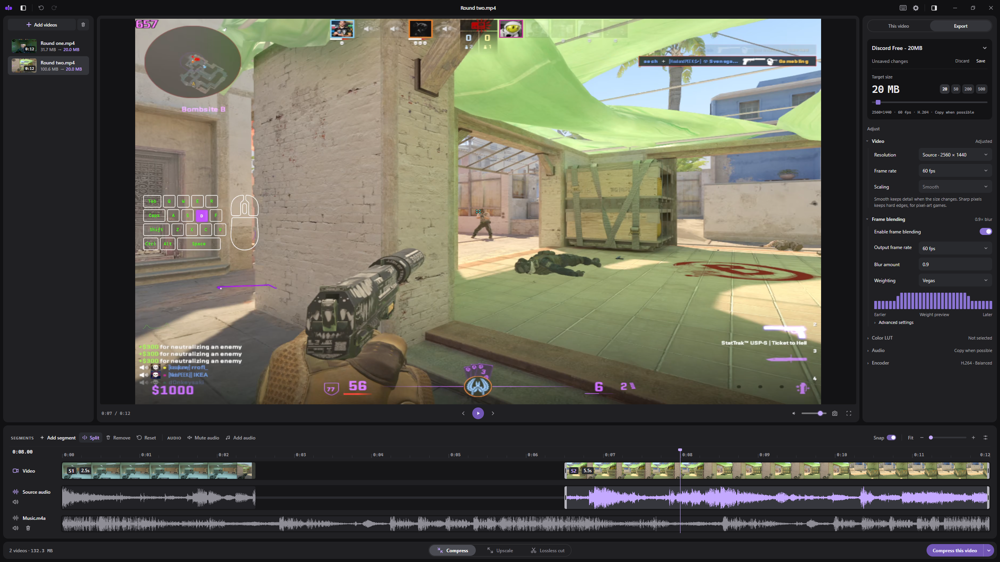
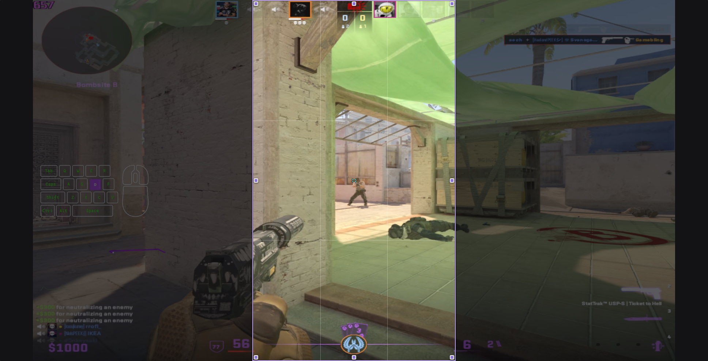

<div>
<h1 align="center">
  <a href="https://tuck.video"></a>
  <br>
  Tuck
</h1>

<p align="center"><strong>Trim, compress, and upscale videos.</strong></p>

<p align="center">
  <a href="https://github.com/aechXIII/Tuck/releases/latest"></a>
  <a href="https://github.com/aechXIII/Tuck/releases"></a>
  <a href="LICENSE"></a>
</p>

<p align="center">
  <a href="https://tuck.video">Website</a>
  &nbsp;&nbsp;&nbsp;
  <a href="https://tuck.video/download/">Download</a>
  &nbsp;&nbsp;&nbsp;
  <a href="https://tuck.video/guide/">Guide</a>
  &nbsp;&nbsp;&nbsp;
  <a href="https://tuck.video/#try">Try the editor</a>
</p>
</div>

---

Tuck is a free and open-source video editor for Windows and Linux, built on FFmpeg. Use it to cut out the parts you don't want, edit the audio, crop a video for a phone screen, or get it under an upload limit.



## Download

Download Tuck from [tuck.video](https://tuck.video/download/) or the [Releases page](https://github.com/aechXIII/Tuck/releases/latest). It runs on Windows 10 and 11 and on x86-64 Linux. FFmpeg is included, and Tuck updates itself.

Windows may say "Windows protected your PC" when you run the installer. That's because it isn't code signed yet. Click More info, then Run anyway. If you'd like to be sure first, compare the file with its [checksum](https://tuck.video/download/#checksums).

On Linux, this command installs Tuck and adds it to your app menu:

```bash
curl -fsSL https://tuck.video/install.sh | sh
```

If anything goes wrong, see the [install guide](https://tuck.video/guide/#install).

## What it does

- Cut out what you don't want. The timeline shows thumbnails to help you find the right spot, and playback skips what you cut, so you see the result before you export.
- If your recording has separate game and mic audio, each one gets its own row and volume. You can add music, even out the loudness, and export everything as one track or keep the tracks separate.
- Crop by dragging on the video, or pick a ratio like 9:16 for TikTok or YouTube Shorts. You can also rotate, flip, and resize.
- Tell Tuck a size, like 20 or 50 MB, and it picks the quality so the video fits under an upload limit.
- **Lossless cut** doesn't re-encode, so you keep the original quality and the export is much faster. Each part has to start on a keyframe, so it may begin a moment after your cut. Switch to **Exact** when that matters.
- Join several videos into one, or copy one video's edits onto others.
- Upscale to 1440p, 4K, or any size you like.
- Turn a 240 fps recording into smooth 60 fps video with motion blur.
- Add a LUT (a `.cube` file) to change the look, and split the preview to see before and after.
- Save any frame as a full-resolution PNG.
- Queue up several exports and retry any that fail. Exports you didn't finish come back the next time you open Tuck.
- Copy finished files and paste them into a chat or a folder. On Linux you can drag them out of Tuck, too.
- Your graphics card plays the preview and can speed up exports: NVIDIA or AMD on Windows, and NVIDIA, Intel, or AMD on Linux. Tuck only offers what works on your computer.
- Save your usual settings as a profile. On Windows, add it to File Explorer's **Send To** menu and send videos to it with a right-click.
- On Windows, you can also compress from a terminal with `tuck compress clip.mp4 --size 25`. The [command line guide](https://tuck.video/guide/#command-line) shows the rest.



## Help

There are step-by-step [guides on tuck.video](https://tuck.video/guide/). In Tuck, press <kbd>?</kbd> to see every keyboard shortcut.

If a video doesn't play right in the preview, turn off **Hardware playback** in **Settings > General** and restart Tuck.

If an export fails, open **Settings > About**, click **Copy** next to **Diagnostic report**, and paste it into a [GitHub issue](https://github.com/aechXIII/Tuck/issues). The report leaves out your file paths.

## Build from source

You'll need Python 3.10 or newer, Node.js 20.19+ or 22.12+, Rust, and FFmpeg. On Windows you also need the MSVC build tools and WebView2. On Linux you need the development packages for Tauri and WebKitGTK 4.1.

To run Tuck from source on Windows:

```powershell
.\scripts\setup.ps1
npm ci
.\scripts\run.ps1
```

On Linux:

```bash
python3 -m venv .venv
.venv/bin/python -m pip install -e '.[dev]'
npm ci
npm run tauri dev
```

If you skip the [native player library](docs/building.md#native-player-library), previews use the built-in player. [docs/building.md](docs/building.md) explains how to build the library, the Windows installer, and the Linux AppImage.

## License

Tuck is licensed under the [GNU General Public License v3.0 only](LICENSE). You can read the third-party notices for [Windows](packaging/THIRD_PARTY_NOTICES.md) and [Linux](packaging/THIRD_PARTY_NOTICES_LINUX.md) here, or in **Settings > About** inside Tuck.

## Acknowledgments

Some frame blending optimizations were inspired by [Interpolini](https://github.com/Z1xus/interpolini).
